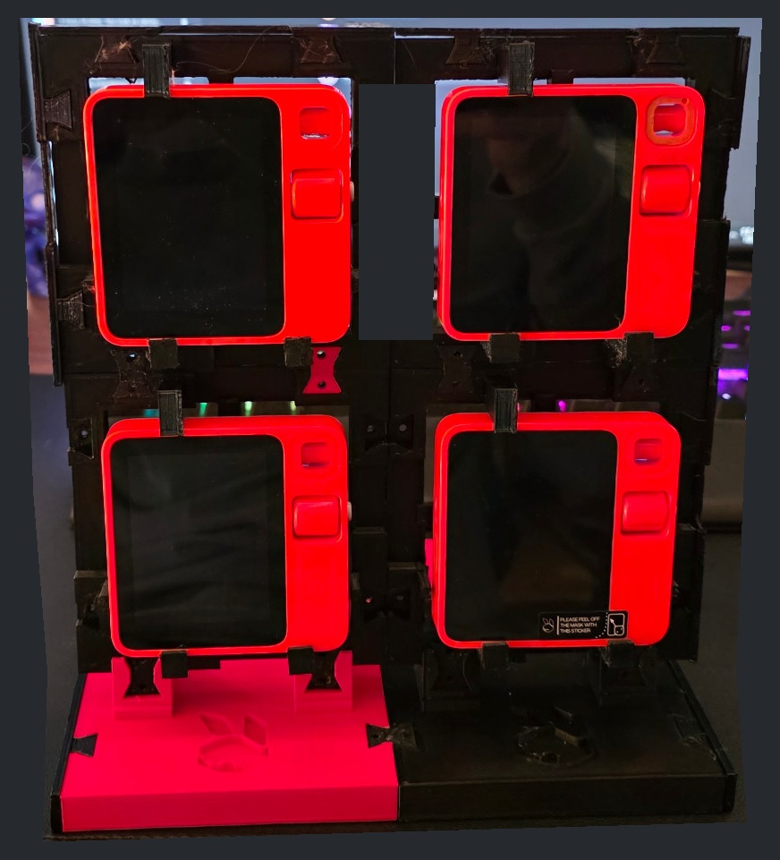
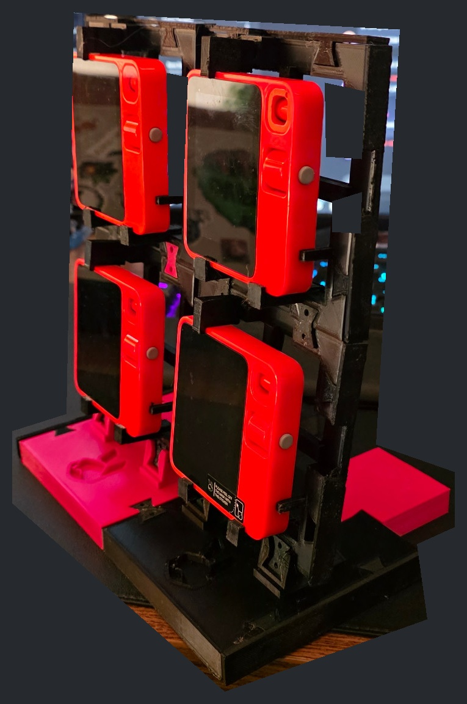
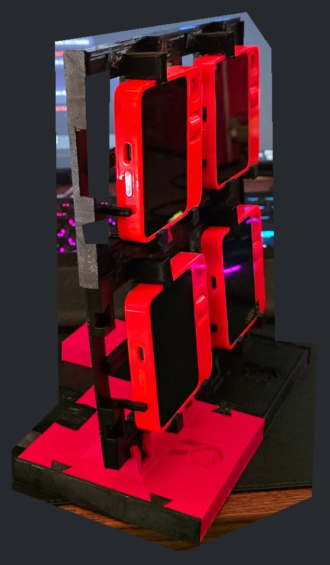

# RabbiRack v1.0.0

A modular, 3D-printable desktop rack for Rabbit r1 devices. Build a single cell or join cells into rows and columns on expandable bases.

**Download:** [v1.0.0 release](https://github.com/GeekTheGreyBeard/RabbiRack/releases/tag/v1.0.0). Start with the **stable-models** archive for the owner-accepted rack, retainers, base, rear foot and bowties. Slice for your own printer; machine-specific G-code is not distributed.

## Free reuse

Rodney / GeekTheGreyBeard dedicates his original contributions to the public domain under **[CC0-1.0](LICENSE)**, to the extent he holds those rights. Copy, modify, redistribute and use them commercially without an attribution requirement. Vendor artwork, third-party material and trademarks are excluded from that dedication. Rabbit/r1 compatibility does not imply endorsement or grant trademark rights. See [scope and notices](docs/attribution.md).

## What version 1 includes

| Component | Status and location |
| --- | --- |
| Rabbit rack cell, keeper, lower caps | Owner accepted; `models/*.stl`. Original geometry unchanged. |
| Base, rear foot, attachment bowtie | Owner fit-verified; `models/base-v1.0/`. Repeated machine print completed successfully. |
| Populated assembly | Owner-supplied photographs show four r1 devices in a two-column, two-high rack. This demonstrates assembly, not a certified load or impact rating. |
| Notched trim v1.0 | Historical optional reference in `models/trim-v1.0/`. Machine print completed; separate trim-fit acceptance not established. Excluded from stable-models archive. |
| Closed trim v1.1 | Local red batch still printing at release preparation; physical outcome pending. Not included as a stable v1 asset. Exterior closed, cable route through rear. |
| Phone panel | **Known inadequate retention; reference only, do not use.** Overall envelope works, retainers do not securely hold the phone. See [issue](docs/phone-retention.md). Excluded from stable-models archive. |

## Build and assemble

- [Bill of materials and modular layouts](docs/bom.md)
- [Assembly and cable routing](docs/assembly.md)
- [Print settings and orientation](docs/printing.md)
- [Rebuild from source and verify](docs/build.md)
- [Base details](docs/base-v1.0.md), [historical trim](docs/trim-v1.0.md)
- [Changelog](CHANGELOG.md), [provenance](docs/provenance.md)

Dimensions are in millimeters. A rack cell is **106 × 106 × 27.6 mm** overall, on a 106 mm joining pitch. The base deck is **106 × 110 × 14 mm**, with saddles reaching 37 mm and a 12.5° backward rack tilt. The rear foot extends the assembled footprint to 158.3 mm depth.

## Owner assembly gallery

These are owner photographs, not CAD renders. Publication copies are cropped with opaque background redactions to remove unrelated monitor content; orientation is preserved and EXIF/GPS metadata removed. Original private photographs are not distributed. Visible assembly pixels are photographic; no product features were generated. Photos are evidence of the shown build, not proof of every future layout or fit.
