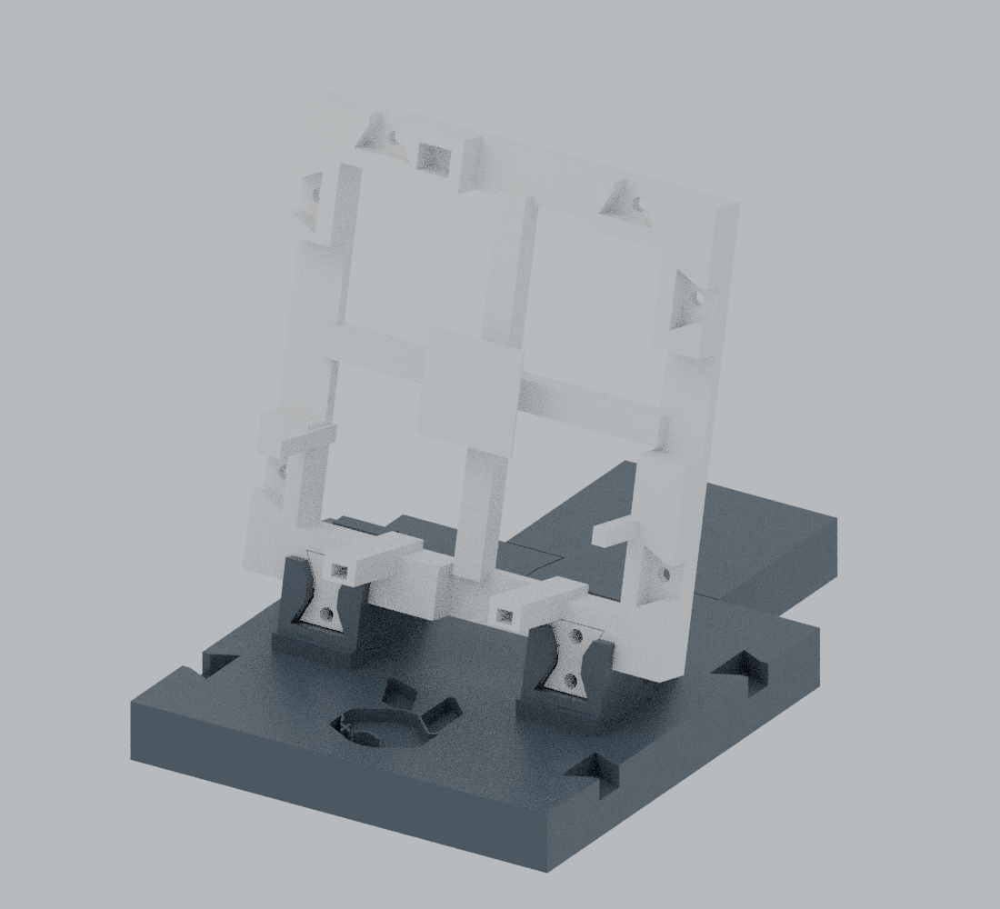

# RabbiRack

A modular printable rack for Rabbit r1 devices, with removable retainers and an expandable base.



## Current design status

| Component | Files | Status |
| --- | --- | --- |
| Rabbit rack cell and retainers | `models/*.stl` | Owner accepted; original mesh bytes unchanged. |
| Base and rear foot | `models/base-v1.0/` | Owner reports perfect base fitment, October 24, 2026. This is not a universal load/stability rating. |
| Edge trim and stack bowties | `models/trim-v1.0/` | First physical batch started October 24; printing at publication. Physical trim fit and retention are not yet verified. |
| Phone panel | `models/phone-v1.0-reference/` | **Reference only — inadequate phone retention.** Owner confirms overall size works with RabbiRack but retainers are too open to hold the phone securely. Awaiting photos; do not print this revision for use. |

Dimensions are in millimeters. CAD illustrations are not photographs or evidence of physical fit. Existing accepted parts are preserved; the base, trim and phone sources are versioned separately.

## Rabbit cell assembly

Use one `corrected-rack-section.stl`, one `keeper-0p25.stl` and two `lower-cap-0p20.stl` per cell.

1. Let parts cool and remove loose strings without changing mating faces.
2. Seat the two lower caps gently, with lips pointing inward.
3. Support the frame horizontally. Remove the top keeper, place the device on the rear pad, and slide it about 3 mm downward beneath the lower lips.
4. Insert the keeper gently. Reverse this sequence for removal.
5. Check rocking, retention and control access with the actual device. Do not force stems or invert a friction-fit assembly over an unprotected surface.

Caps are exported on their flat top faces with stems upward; the keeper is on its side. See [base assembly](docs/base-v1.0.md), [trim quantities and fitting order](docs/trim-v1.0.md), and [phone retention issue](docs/phone-retention.md).

## Rebuild and verify

Requires Blender with bundled Python. Verified with Blender 5.0.1:

```sh
blender --background --factory-startup --threads 2 --python source/buildRack.py
blender --background --factory-startup --threads 2 --python source/buildBase.py
blender --background --factory-startup --threads 2 --python source/buildTrim.py
(cd models && sha256sum -c SHA256SUMS)
```

Outputs default to `build/`, `build/base-v1.0/` and `build/trim-v1.0/`. Set `RABBIRACK_OUTPUT` to override. `source/buildPhoneReference.py` reproduces the historical phone geometry solely for investigation; it is not a print recommendation. Its lower caps are the original `models/lower-cap-0p20.stl`.

The publication checks regenerate and compare the meshes with Blender 5.0.1. Other Blender versions may change Boolean triangulation or binary output; checked-in STL files remain the reference. Each generator checks one connected solid, positive volume and no nonmanifold edges. These checks do not establish physical strength or retention.

Slice for your own printer and material. Printer-specific G-code, profiles, slicer archives, private photographs and execution logs are intentionally excluded. No additional print is authorized by this repository update.

See [provenance](docs/provenance.md) and [attribution and licensing](docs/attribution.md).
