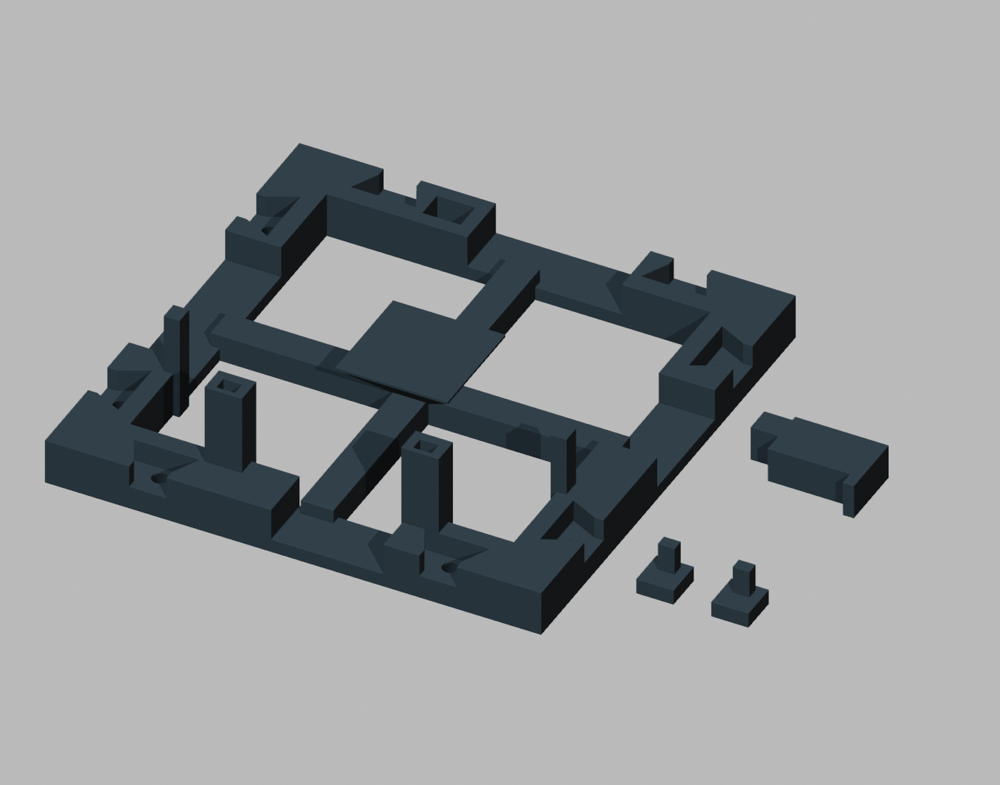

# RabbiRack

A printable rack cell with removable retainers for the Rabbit r1.



## What is included

Print one `models/corrected-rack-section.stl`, one `models/keeper-0p25.stl`, and two copies of `models/lower-cap-0p20.stl`. Dimensions are in millimeters. These are the accepted single-unit meshes, preserved byte-for-byte. The image is a synthetic view of the separate printable parts, not an assembled or physically tested stack.

Rodney reports a near-perfect fit of one unit, close enough to work with, and accepted this geometry. Stack and base stability have **not** been physically validated. The cell alone is not freestanding. This is not a claim of universal fit, holding strength, drop safety, or production readiness.

## Assembly

1. Allow the parts to cool and remove loose strings without changing mating faces.
2. Seat two lower caps gently in the lower bracket sockets, with their lips pointing inward.
3. Support the frame horizontally. With the top keeper removed, place the device on the rear pad and slide it roughly 3 mm downward beneath the lower lips.
4. Insert the top keeper gently. To remove the device, remove the keeper, slide upward, then lift free.
5. Check retainer security, rocking, face clearance and access with your own device. Do not force stems or invert the friction-fit assembly over an unprotected surface.

The source documentation suggests printing the caps on their flat top faces with stems upward and the keeper on its side; the meshes are exported in these orientations. Slice for your own printer and material. Machine-specific G-code and slicer projects are intentionally not included.

## Rebuild and verify

Requires Blender with its bundled Python. Verified with Blender 5.0.1:

```sh
blender --background --factory-startup --python source/buildRack.py
(cd models && sha256sum -c SHA256SUMS)
```

The generator writes to `build/` by default. Set `RABBIRACK_OUTPUT` to select another output directory. All three regenerated STL files matched the accepted SHA-256 hashes exactly in the verified environment. Blender versions may affect Boolean triangulation or binary output. The checked-in meshes remain the accepted reference.

The generator retains helper construction for joint keys and alternate keeper clearances to preserve the original construction sequence, but exports only the three accepted parts. These internal variants are not accepted accessories. Failed experiments, bases, trim, gauges, private photos and print logs are omitted.

See [provenance](docs/provenance.md) and [attribution and licensing](docs/attribution.md).
