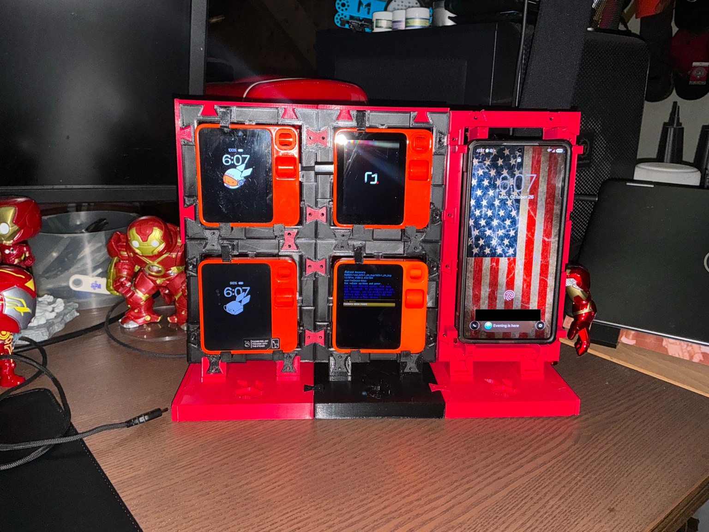

# Phone holder v1.1 — owner fit-verified

The owner tested the printed revision with his actual cased phone and reports that it fits perfectly and the integral pegs hold it securely **without removable retainer caps**. No caps were printed in this revision's test. Caps were neither tested nor found necessary for that fit; this is not a universal case-fit or impact/load certification.

Download [the exact printed panel STL](../models/phone-v1.1/phone-panel.stl). Rebuild with [buildPhone.py](../source/buildPhone.py). This is a main-branch addition; the v1.0.0 release tag and archives remain unchanged.

## Exact change

The outside remains **106 × 212 × 30.4 mm**, one rack cell wide and two high. The backing, rear opening, joining sockets and cap sockets are unchanged from v1.0. Only peg contact reach changed:

| Contacts | Inward addition per opposing side | Total gap taken up |
| --- | ---: | ---: |
| Top and bottom posts | 2.38125 mm | 4.7625 mm (3/16 inch) |
| Left and right guides | 3.175 mm | 6.35 mm (1/4 inch) |

These are total corrections, not per-side measurements. Resulting modeled contact spans are 82.65 mm horizontally and 166.4375 mm vertically. They follow the owner's measurements on the actual printed holder and cased phone. The older nominal 87.376 × 169.418 × 15.24 mm case envelope conflicts with these spans and was not treated as a passed insertion test. Owner physical acceptance supersedes that approximation for this particular setup; it does not establish compatibility with every case advertised at those dimensions.

The original design reference was Galaxy S25 Ultra / UAG Plasma XTE MagSafe Ash/Titanium, SKU 214467113136. Exact local case contours were not modeled. Check your own device before trusting retention.

## Print and assemble

Print one panel flat on its rear plane, with integral pegs pointing up. Do not scale the STL: scaling changes rack interfaces. The successful PLA run used a 0.4 mm nozzle, 0.2 mm layers, four perimeters, 20% infill, 215°C first layer / 210°C subsequent nozzle temperature, 60°C bed, 0.6 mm retract lift and perimeter avoidance. Slice for your own printer; no machine-specific G-code is published.

The panel-only slice estimated 62.97 g PLA and 8h 40m. Machine completion was recorded October 26, 2026 at 23:43:33 UTC after 8h 43m 43s, all bytes processed, successful history and heaters off. Mesh validation found one connected solid, positive volume and zero nonmanifold edges. Digital travel checks found no modeled penetration, but do not predict curling or plate movement.

Let the part cool and remove brim/skirt debris if present. Support the holder, seat the actual cased phone from the front between the pegs, and check that contacts bear on the case rather than screen, buttons or camera. Do not force insertion. Confirm charging-port access and route cables behind the rack without pulling the phone sideways. To remove, support the frame and ease the phone out from the front without bending the pegs or prying against glass.

Use existing compatible bowtie keys at the rack joining interfaces. A full-height side connection to two stacked rack cells has four key positions; reuse installed keys where available. Base attachments follow the existing base assembly guide. Retention pegs and structural bowties serve different purposes. Check supported assembly stability before loading.

## Photographs

Owner-supplied photograph of the actual fitted assembly, published with permission. A plain opaque rectangle covers lock-screen name/email text. Every decoded pixel outside that mask is identical to the original photograph; dimensions and orientation are preserved. The lossless publication copy contains no EXIF/GPS or other embedded metadata. No generative edits were used in this published image. The original remains private. Physical retention acceptance is the owner's report; a photograph alone does not certify holding force.

The [historical v1.0](phone-retention.md) remains available as a clearly marked inadequate-retention reference, not the recommended holder.
