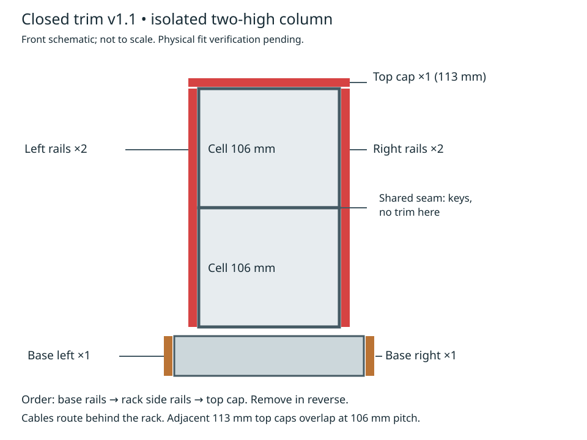

# Closed trim v1.1 — physical fit verification pending

These are the exact five rail meshes used in the packed red v1.2 print. They close the historical exterior access notches without changing the rack, base, joining sockets or integral attachment tongues. The print was still running when this addition was prepared; mesh and nominal assembly checks are not physical fit acceptance. This main-branch addition does not alter the v1.0.0 tag or release assets.

## Files and orientation

Left/right are named while facing the device fronts. All dimensions below describe the assembled rail, not the print bounding box.

| File in models/trim-closed-v1.1 | Use | Length × frame depth | Print orientation |
| --- | --- | --- | --- |
| rack-left.stl | Exposed left edge of one cell | 106 × 10 mm | Broad outer face down; tongues upward |
| rack-right.stl | Exposed right edge of one cell | 106 × 10 mm | Broad outer face down; tongues upward |
| rack-top.stl | Exposed top of an isolated column | 113 × 10 mm | Broad outer face down; tongues upward |
| base-left.stl | Exposed left side of base | 110 × 14 mm | Broad outer face down; tongues upward |
| base-right.stl | Exposed right side of base | 110 × 14 mm | Broad outer face down; tongues upward |

Walls are 3.2 mm thick with 0.3 mm nominal side gap. Integral half-bowtie tongues retain the V2 polygon inset of 0.25 mm and 4.4 mm thickness; no extra trim clips are needed. Base rails are unchanged from historical v1.0. The rack rails fill only the former exterior notch volumes at frame Z3..10; the rear plane and interior opening are unchanged. Leave exported STLs in their supplied printing orientation. Nominal print height is 11.25 mm. See [printing guidance](printing.md) for the proven PLA baseline and travel clearance caveats.

## Quantities and supported arrangement

| Layout | Left rack rails | Right rack rails | Top caps | Left base rails | Right base rails |
| --- | ---: | ---: | ---: | ---: | ---: |
| One isolated cell on one base | 1 | 1 | 1 | 1 | 1 |
| One isolated column, two cells high | 2 | 2 | 1 | 1 | 1 |
| One isolated column, N cells high | N | N | 1 | 1 | 1 |

The N-row formula counts exposed edges only; it is not approval of arbitrary stack heights. The owner's current batch requests 3 top caps, 3 left and 3 right rack rails, plus 2 left and 2 right base rails. That is a batch inventory, not a claim that every part belongs on one continuous array.

**Do not place rails on shared cell seams or the occupied base-to-rack edge.** Structural bowties remain separate: two per joined seam, including two per base attachment. Reuse existing keys and device retainers rather than counting integral trim tongues as loose bowties.

**Side-by-side top-cap limitation:** each 113 mm cap overhangs a 106 mm cell by 3.5 mm at either end. Two such caps placed on adjacent cells at 106 mm pitch overlap by 7 mm. They are therefore documented for isolated columns, not as a continuous top trim across a multi-column array. Do not force overlapping caps or assume the populated two-by-two photo validates this closed trim arrangement. No geometry was modified to resolve that separate layout issue.

## Install and remove

1. Fit the base side rails first, lowering their tongues into the unused top-open base side pockets (Y25 and 85). Do not cover sockets needed to join adjacent bases.
2. Assemble and key the rack column to the base and any upper cells. Preserve all keepers and lower device caps.
3. Fit the appropriate left/right rails on exposed cell sides. Align both tongues at Y22 and 84, then insert from the front toward the frame's rear. Do not pry or force tight parts.
4. Fit the single top cap at the exposed upper edge, with its ends covering the side-rail ends. Do not install one at an internal horizontal seam.
5. Check seating, device/control clearance, USB plug fit and cable slack before loaded use. Closed sides intentionally cover former perimeter access windows; remove trim if access is needed.
6. Remove in reverse order: top and rack side rails first, then lift base rails upward. Installed rack side rails obstruct the base rails' upward removal path.

## Rear cable management and validation limits

Route cables through the back, as requested by the owner. No exterior cable notch or cable clip is added. Owner-added cable attachments and exact USB plug bend radii are not modeled. The unchanged rear opening provides the route; check actual connectors and avoid cable pull on the device or rack.

All five meshes are single connected, positive-volume manifolds. Source regeneration is checked with Blender 5.0.1. Nominal two-high isolated-column assembly and sampled insertion checks found no interference with the stated order; Boolean comparison confirms only exterior notch filling, unchanged mating geometry and unchanged base rails. This does not prove printed tolerance, retention, strength, adhesion or cable fit. Closed trim is an optional pending-fit accessory, not a structural reinforcement.

Rebuild: `blender --background --factory-startup --threads 2 --python source/buildClosedTrim.py` from repository root. Default output is `build/trim-closed-v1.1/`; the generator also reproduces the unchanged reference stack key. Use `models/base-v1.0/attachment-key-0p25.stl` for the existing bowtie; it is not newly counted with trim. Verify published meshes with `(cd models && sha256sum -c SHA256SUMS)`.
