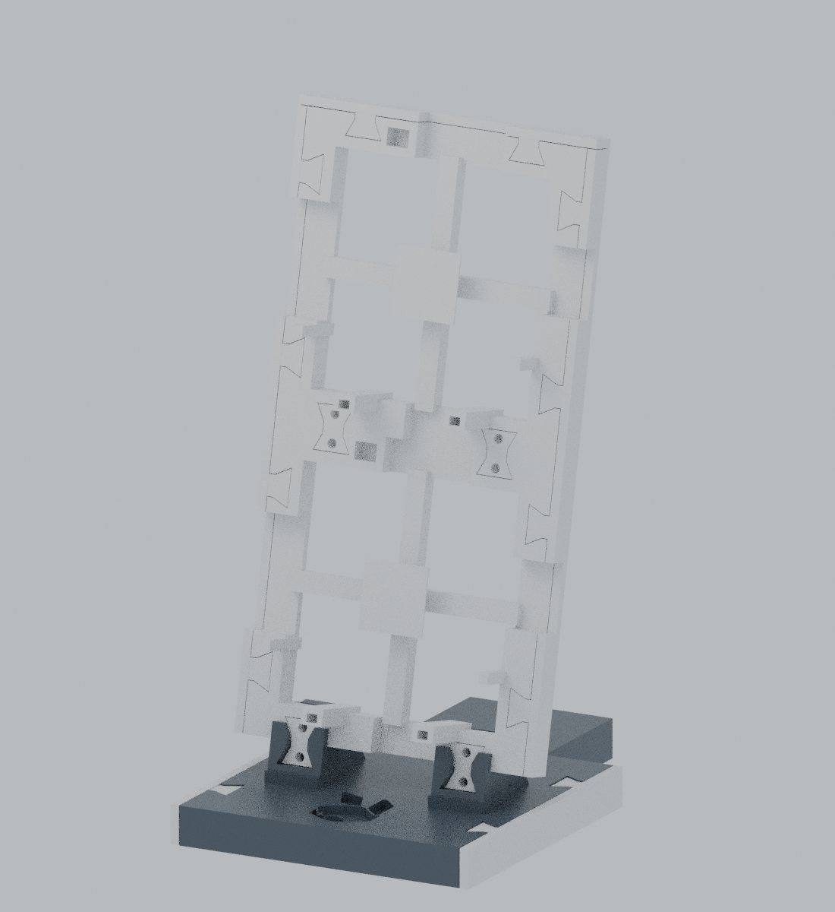

> Historical optional reference. Its October 24 machine job completed successfully; physical trim-fit acceptance is not established. Excluded from the v1.0.0 stable-models archive. Closed trim is separate in-progress work.

# Trim v1.0 — completed machine print, physical fit pending

This revision finishes one base and two Rabbit rack cells stacked vertically at the existing 106 mm pitch. The owner authorized the first batch on October 24, 2026. The machine job completed successfully on October 24. Separate owner acceptance of trim fit is not established.

## Exact batch and existing parts

| New part | Quantity |
| --- | ---: |
| `rack-left.stl` | 2 |
| `rack-right.stl` | 2 |
| `rack-top.stl` | 1 |
| `base-left.stl` | 1 |
| `base-right.stl` | 1 |
| `stack-key.stl` | 2 |

Total: seven trim rails and two bowties. Each rail includes two integral half-bowtie tongues, so separate trim clips are unnecessary. Reuse the two existing base attachment keys, existing keepers and lower caps. Four previously printed phone keys remain allocated to that assembly; they are not duplicated here. No rack, base, phone part, spare retainer or hidden-hardware fascia is part of this batch.

The two new bowties join the cells across their common edge at X22 and X84. There is no trim at that internal seam or the occupied base attachment edge. The single base's plain front/back edges have no unused side pockets to cover.

## Fit and assembly order

The earlier trim models were unattached concept solids. These rails add tongues using the existing V2 socket polygon with 0.25 mm inset and 4.4 mm thickness. Rail thickness is 3.2 mm with 0.3 mm nominal side clearance. Rack sides are 106 mm long and 10 mm deep; base sides are 110 mm long and 14 mm deep. The 113 mm top cap spans both side ends.

Control reliefs preserve the accepted openings: left Y35–75, right Y48.3–72.3, top X42–75, retaining the existing 3 mm rear rim. Identify left/right by these openings. Actual installed cable clearance still needs checking.

1. Fit the base side trims first, inserting downward into the open pockets.
2. Join the two rack cells with the new bowties; retain the installed base keys.
3. Fit rack side trims from the front, then the uppermost top cap.
4. Reverse the order for removal. Rack side trims obstruct the upward removal path of base trim when left installed.

Fit gently; do not force or glue a tight tongue. These removable covers do not strengthen or qualify the stack.

## Digital validation

All meshes are connected, positive-volume manifolds. Actual CAD assembly and sampled insertion checks pass with the stated fitting order. Rails are exported on their broad outer edges so the tongues grow upward. The first slice reported no support warning. Machine-specific verification retained the successful perimeter avoidance and 0.6 mm travel lift; modeled deposited-path replay found no penetration, including the earlier roof-transition height region. Short moves and wipes can remain coplanar. Ideal geometry cannot exclude curling, plate slip or physical nozzle contact.

The local batch estimate was 31.09 g PLA and 4h 24m 47s. These are estimates for the owner's profile, not portable guarantees. Physical trim fit, retention and finished quality remain pending.

